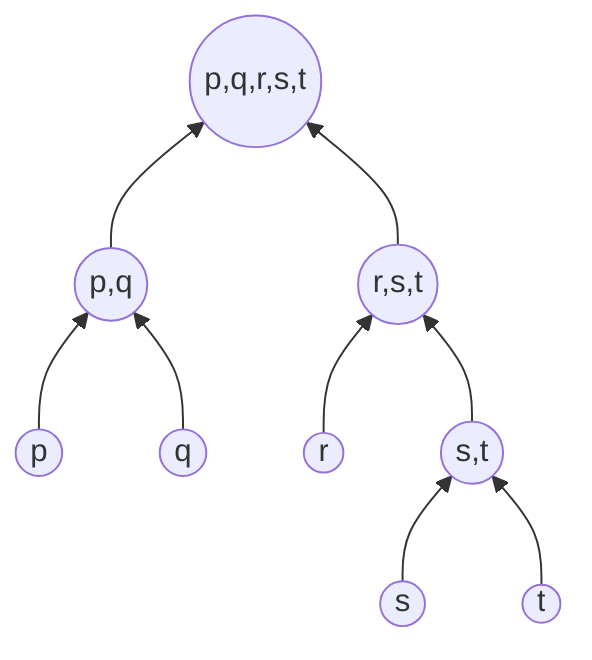

# 04 — Clustering and K-Means

> Handwritten: [pp. 5–20](../handwritten-notes/neural-network-handwritten-notes.pdf) · Exam: DUET 2018–19, Q4(a), Q4(b), Q6(a) · Code: [`kmeans.py`](../src/nncourse/kmeans.py)

## Clustering

Clustering divides data points into groups so that points in the same group are much more similar to each other than to points in other groups. It is **unsupervised**: no labels are used.

## Q: Explain different types of clustering

**By membership**

- **Hard clustering:** each point belongs to exactly one cluster (e.g., K-means).
- **Soft clustering:** each point gets a probability of belonging to every cluster (e.g., Gaussian mixture models, fuzzy C-means).

**By model**

| Type | Idea | Example | Strengths | Weaknesses |
|---|---|---|---|---|
| **Centroid-based** | Flat partition around central points | K-means | Simple, efficient | Sensitive to outliers and to the initial centers; assumes roughly spherical clusters |
| **Density-based** | Clusters are dense regions separated by sparse regions | DBSCAN | Arbitrary shapes; marks outliers as noise | Struggles when density varies, and in high dimensions |
| **Distribution-based** | Data is generated by a mixture of distributions; points are grouped by likelihood | Gaussian mixture (EM) | Soft assignments; elliptical clusters | Must assume a distribution; can overfit |
| **Hierarchical** | Builds a tree (dendrogram) of nested clusters | Agglomerative (bottom-up), divisive (top-down) | Suits data with natural levels or taxonomies; any number of clusters by cutting the tree | O(n²) memory or worse; merges cannot be undone |


*Agglomerative clustering builds this tree bottom-up (merging); divisive clustering builds it top-down (splitting).*

## Q: What is the elbow technique?

The elbow method chooses the number of clusters `K`. For each K, run K-means and compute the **sum of squared errors** (within-cluster SSE):

```text
SSE = Σ_{k=1}^{K} Σ_{x ∈ C_k} dist(x, c_k)²
```

SSE always decreases as K grows (with K = n, it is 0), so we cannot just minimize it. Plot SSE against K and choose the K where the curve **stops dropping sharply and flattens**, the "elbow". Beyond that point, extra clusters give little improvement. In the sketch in my notes, the elbow is at K = 4.

## Q: Advantages and disadvantages of K-means

**Advantages**

1. Fast, robust and easy to understand.
2. Relatively efficient: `O(t·k·n·d)` for n objects, k clusters, d dimensions and t iterations; normally `k, t, d ≪ n`.
3. Gives the best results when the clusters are distinct and well separated.

**Disadvantages**

1. **Choosing K:** the number of clusters must be specified in advance.
2. **Overlap:** hard (exclusive) assignment, so heavily overlapping groups cannot be separated.
3. **Shape:** fails on non-convex or non-linearly separable clusters (e.g., concentric rings).
4. **Distance:** Euclidean distance weights all features equally, so features must be scaled.
5. **Initialization:** different initial centers can give different results (local optima). *(Added when typing up: K-means++ or multiple restarts mitigate this.)*
6. **Categorical data:** means are undefined for categorical features (K-modes is used instead). *(Added when typing up.)*
7. **Noise and outliers:** a single outlier can pull a center far from its cluster, because the mean is not robust. *(Added when typing up.)*

---

## Problem 1: K-means with Manhattan distance

Cluster the eight points into three clusters:

```text
A1(2,10)  A2(2,5)  A3(8,4)  A4(5,8)  A5(7,5)  A6(6,4)  A7(1,2)  A8(4,9)
```

Initial centers: `A1(2,10)`, `A4(5,8)`, `A7(1,2)`. Distance: `ρ(a, b) = |x₂ − x₁| + |y₂ − y₁|`. Find the three cluster centers after the **second iteration**.

> Verified by [`test_kmeans_manhattan_two_iterations`](../tests/test_worked_examples.py)

### Iteration 1

| Point | to C1 (2,10) | to C2 (5,8) | to C3 (1,2) | Cluster |
|---|---:|---:|---:|:---:|
| A1 (2,10) | **0** | 5 | 9 | C1 |
| A2 (2,5) | 5 | 6 | **4** | C3 |
| A3 (8,4) | 12 | **7** | 9 | C2 |
| A4 (5,8) | 5 | **0** | 10 | C2 |
| A5 (7,5) | 10 | **5** | 9 | C2 |
| A6 (6,4) | 10 | **5** | 7 | C2 |
| A7 (1,2) | 9 | 10 | **0** | C3 |
| A8 (4,9) | 3 | **2** | 10 | C2 |

New centers (means):

```text
C1 = (2, 10)                                           only A1
C2 = ((8+5+7+6+4)/5, (4+8+5+4+9)/5) = (30/5, 30/5) = (6, 6)
C3 = ((2+1)/2, (5+2)/2) = (1.5, 3.5)
```

### Iteration 2

| Point | to C1 (2,10) | to C2 (6,6) | to C3 (1.5,3.5) | Cluster |
|---|---:|---:|---:|:---:|
| A1 (2,10) | **0** | 8 | 7 | C1 |
| A2 (2,5) | 5 | 5 | **2** | C3 |
| A3 (8,4) | 12 | **4** | 7 | C2 |
| A4 (5,8) | 5 | **3** | 8 | C2 |
| A5 (7,5) | 10 | **2** | 7 | C2 |
| A6 (6,4) | 10 | **2** | 5 | C2 |
| A7 (1,2) | 9 | 9 | **2** | C3 |
| A8 (4,9) | **3** | 5 | 8 | **C1** ← moved from C2 |

New centers:

```text
C1 = ((2+4)/2, (10+9)/2) = (3, 9.5)
C2 = ((8+5+7+6)/4, (4+8+5+4)/4) = (26/4, 21/4) = (6.5, 5.25)
C3 = ((2+1)/2, (5+2)/2) = (1.5, 3.5)
```

### Answer

```text
After the second iteration:  C1 = (3, 9.5),  C2 = (6.5, 5.25),  C3 = (1.5, 3.5)
```

### Going further: convergence

The algorithm has **not** converged yet. In iteration 3, A4(5,8) is at distance 3.5 from C1(3, 9.5) and 4.25 from C2(6.5, 5.25), so it **moves to C1**. Iteration 4 changes nothing, giving the final clusters:

```text
C1 = {A1, A4, A8} → (3.67, 9)     C2 = {A3, A5, A6} → (7, 4.33)     C3 = {A2, A7} → (1.5, 3.5)
```

> Verified by [`test_kmeans_manhattan_converges_after_three_iterations`](../tests/test_worked_examples.py)

*Note:* the mean minimizes squared Euclidean error. With Manhattan distance, the error-minimizing center is the **median** (the K-medians algorithm). Exam problems conventionally still use the mean, as here.

---

## Problem 2: Grouping medicines (DUET 2018–19, Q4b)

Four medicines with two features. Form K = 2 groups with K-means.

| Medicine | Weight index | pH |
|---|---:|---:|
| a | 1 | 1 |
| b | 2 | 3 |
| c | 4 | 5 |
| d | 3 | 1 |

Distance: squared Euclidean, `d² = (x₂ − x₁)² + (y₂ − y₁)²`. Initial centers: `C1 = a(1,1)`, `C2 = b(2,3)`.

> Verified by [`test_kmeans_medicines`](../tests/test_worked_examples.py)

### Iteration 1

| Point | d² to C1 (1,1) | d² to C2 (2,3) | Cluster |
|---|---:|---:|:---:|
| a (1,1) | **0** | 5 | C1 |
| b (2,3) | 5 | **0** | C2 |
| c (4,5) | 25 | **8** | C2 |
| d (3,1) | **4** | 5 | C1 |

```text
C1 = ((1+3)/2, (1+1)/2) = (2, 1)
C2 = ((2+4)/2, (3+5)/2) = (3, 4)
```

### Iteration 2

| Point | d² to C1 (2,1) | d² to C2 (3,4) | Cluster |
|---|---:|---:|:---:|
| a (1,1) | **1** | 13 | C1 |
| b (2,3) | 4 | **2** | C2 |
| c (4,5) | 20 | **2** | C2 |
| d (3,1) | **1** | 9 | C1 |

The assignments did not change, so the algorithm has **converged**.

### Answer

```text
Group 1 = {a, d},  center (2, 1)        Group 2 = {b, c},  center (3, 4)
```

---

## Corrections to the handwritten version

- p. 17: the alternative-solution page for iteration 2 ends with "completion of iteration-01"; it should read *iteration-02*.
