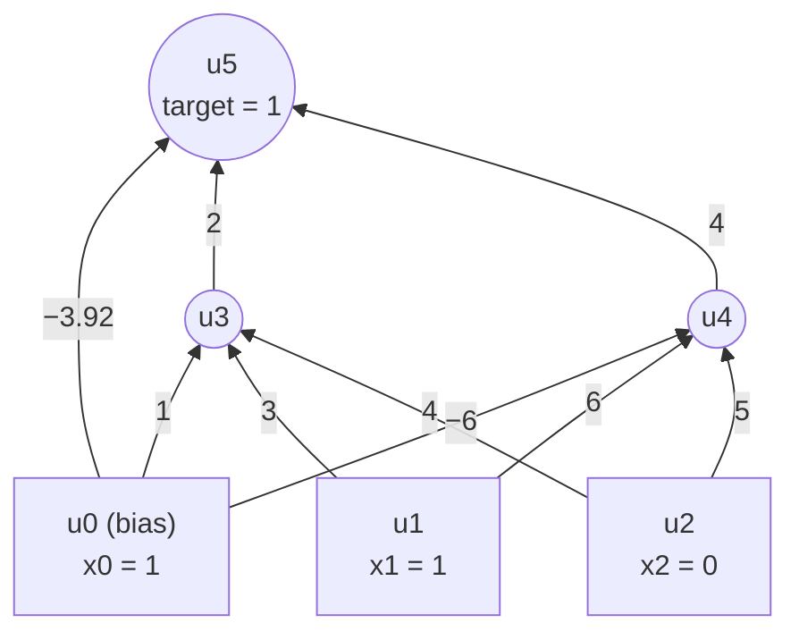

# 05 — Multilayer Perceptron and Backpropagation

> Handwritten: [pp. 21–27](../handwritten-notes/neural-network-handwritten-notes.pdf) (Lecture 05) · Code: [`mlp.py`](../src/nncourse/mlp.py) · Verified by [`test_backprop_*`](../tests/test_worked_examples.py)

## Problem

A 2-2-1 network with sigmoid units. Perform **one forward pass, one backward pass and one weight update**, then verify that the error decreased.



| Weights into u3 | Weights into u4 | Weights into u5 |
|---|---|---|
| w03 = 1 | w04 = −6 | w05 = −3.92 |
| w13 = 3 | w14 = 6 | w35 = 2 |
| w23 = 4 | w24 = 5 | w45 = 4 |

Activation: `y = σ(a) = 1 / (1 + e^(−a))`, where `a_j = Σ_i w_ij x_i`. Learning rate `η = 0.1`.

*(The figure labels w05 as −3.93; the lecture uses −3.92 in the calculation.)*

---

## Step 1: Forward pass

**Hidden unit u3:**

```text
a3 = w03·x0 + w13·x1 + w23·x2 = 1·1 + 3·1 + 4·0 = 4
y3 = σ(4) = 1 / (1 + e^−4) ≈ 0.982
```

**Hidden unit u4:**

```text
a4 = w04·x0 + w14·x1 + w24·x2 = −6·1 + 6·1 + 5·0 = 0
y4 = σ(0) = 0.5
```

**Output unit u5:**

```text
a5 = w05·x0 + w35·y3 + w45·y4 = −3.92 + 2·0.982 + 4·0.5 = 0.044
y5 = σ(0.044) ≈ 0.511
```

**Error:** `t − y5 = 1 − 0.511 = 0.489`. The output is far from the target.

---

## Step 2: Backward pass (deltas)

For a sigmoid unit, `σ'(a) = y(1 − y)`. The deltas are:

```text
output:   δ5 = y5 (1 − y5) (t − y5)
hidden:   δj = yj (1 − yj) Σ_k δk w_jk
```

A hidden unit has no target of its own, so it receives its share of the output error through the connecting weight. This is the chain rule at work.

```text
δ5 = 0.511 × 0.489 × 0.489 ≈ 0.1222
δ4 = y4 (1 − y4) · δ5 · w45 = 0.5 × 0.5 × 0.1222 × 4 ≈ 0.1222
δ3 = y3 (1 − y3) · δ5 · w35 = 0.982 × 0.018 × 0.1222 × 2 ≈ 0.0043
```

**Observation:** δ3 is about 28× smaller than δ4, although w35 and w45 are similar. The reason is that u3 is **saturated** (y3 ≈ 0.982, so `y3(1 − y3) ≈ 0.018`, compared with 0.25 for u4). This is the vanishing-gradient effect of the sigmoid in miniature.

*(The handwritten notes round y5 to 0.51, giving δ5 = δ4 ≈ 0.1225. The difference is only rounding.)*

---

## Step 3: Weight update (generalized delta rule)

```text
Δw_ij = η · δj · y_i          w_ij(new) = w_ij(old) + Δw_ij
```

where `δj` belongs to the unit **receiving** the weight and `y_i` is the output of the unit **sending** it (`x_i` for input units). All deltas use the old weights.

| Weight | Δw = η·δ·input | New value |
|---|---|---:|
| w03 | 0.1 × 0.0043 × 1 = 0.00043 | 1.0004 |
| w13 | 0.1 × 0.0043 × 1 = 0.00043 | 3.0004 |
| w23 | 0.1 × 0.0043 × 0 = 0 | 4.0000 |
| w04 | 0.1 × 0.1222 × 1 = 0.0122 | −5.9878 |
| w14 | 0.1 × 0.1222 × 1 = 0.0122 | 6.0122 |
| w24 | 0.1 × 0.1222 × 0 = 0 | 5.0000 |
| w05 | 0.1 × 0.1222 × 1 = 0.0122 | −3.9078 |
| w35 | 0.1 × 0.1222 × 0.982 = 0.0120 | 2.0120 |
| w45 | 0.1 × 0.1222 × 0.5 = 0.0061 | 4.0061 |

Weights from x2 do not change, because x2 = 0 contributes nothing to the error.

---

## Step 4: Verify with a second forward pass

```text
a3 = 1.0004 + 3.0004 + 0           = 4.0009    y3 ≈ 0.9820
a4 = −5.9878 + 6.0122 + 0          = 0.0244    y4 ≈ 0.5061
a5 = −3.9078 + 2.0120·0.9820 + 4.0061·0.5061 ≈ 0.0956    y5 ≈ 0.5239
```

| | Before | After one update |
|---|---:|---:|
| Output y5 | 0.511 | 0.524 |
| Error t − y5 | 0.489 | 0.476 |

**A single backpropagation step reduced the error by about 0.013**, moving the network toward the target. Repeated steps continue this descent on the error surface.

---

## Corrections to the handwritten version

- Page "⑤" of the original calculation (updates of w13, w23 and w04) is missing from the scan. The values above complete it. The second forward pass on p. 27 already uses w04(new) = −5.9878.
- p. 27: "New error: 1 − 5239" should read **1 − 0.5239 = 0.476**.
