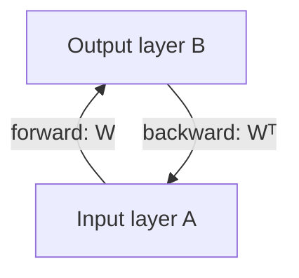

# 08 — Bidirectional Associative Memory (BAM)

> Handwritten: [pp. 33–38](../handwritten-notes/neural-network-handwritten-notes.pdf) · Exam: DUET 2020–21 · Code: [`bam.py`](../src/nncourse/bam.py) · Verified by [`test_bam_weight_matrix_and_recall`](../tests/test_worked_examples.py)

## Idea

A BAM (Kosko, 1988) is a two-layer **hetero-associative** memory: it stores pairs of patterns `(A_k, B_k)` and recalls one from the other.

- **Associates different patterns.** Unlike an auto-associative memory, which cleans up a noisy version of the *same* pattern, a BAM links an input pattern to a *different* output pattern.
- **Bidirectional.** Activation passes A → B through `W` and B → A through `Wᵀ`. The forward and backward connections share the same matrix, transposed.
- **Resonance.** Activity bounces back and forth between the layers until the patterns stop changing, a **stable state**.
- **Robust recall.** A BAM can often retrieve the correct pair from a noisy or incomplete probe.



## Algorithm

**Storage (outer-product / Hebbian rule):**

```text
W = Σ_k A_kᵀ B_k
```

**Recall** with a bipolar hard limiter:

```text
B = f(A W),     A = f(B Wᵀ),     f(a) = +1 if a > 0,  −1 if a < 0,  unchanged if a = 0
```

## Problem (DUET 2020–21)

Store three pairs of bipolar vectors in a BAM using the outer product, and show that A1 recalls B1 and vice versa.

| Original | Associated |
|---|---|
| A1 = [1, −1, −1] | B1 = [1, −1] |
| A2 = [−1, 1, −1] | B2 = [−1, 1] |
| A3 = [−1, −1, 1] | B3 = [1, −1] |

## Solution

### Weight matrix

Each outer product takes `A_k` as a column and `B_k` as a row:

```text
A1ᵀB1 = [ 1 −1]     A2ᵀB2 = [ 1 −1]     A3ᵀB3 = [−1  1]
        [−1  1]             [−1  1]             [−1  1]
        [−1  1]             [ 1 −1]             [ 1 −1]
```

```text
W = A1ᵀB1 + A2ᵀB2 + A3ᵀB3 = [ 1 −1]
                            [−3  3]
                            [ 1 −1]
```

### Forward recall: A1 → B

```text
A1 W = [1, −1, −1] · W = [1 + 3 − 1,  −1 − 3 + 1] = [3, −3]
f([3, −3]) = [1, −1] = B1   ✓
```

### Backward recall: B1 → A

```text
B1 Wᵀ = [1, −1] · [ 1 −3  1 ] = [1 + 1,  −3 − 3,  1 + 1] = [2, −6, 2]
                  [−1  3 −1 ]
f([2, −6, 2]) = [1, −1, 1]   ✗  (A1 = [1, −1, −1])
```

The backward pass does **not** recover A1.

### Why the backward recall fails: crosstalk

Expanding the product shows how every stored pair contributes:

```text
B1 Wᵀ = Σ_k (B1 · B_k) A_k = (B1·B1) A1 + (B1·B2) A2 + (B1·B3) A3
      = 2·A1 − 2·A2 + 2·A3
      = 2·([1,−1,−1] − [−1,1,−1] + [−1,−1,1]) = 2·[1, −3, 1] = [2, −6, 2]
```

Recall works perfectly only if the stored `B` patterns are **orthogonal**, so that only the matching term survives. Here they are not:

- **B1 = B3**, so B1 is equally associated with A1 and A3. The memory cannot decide between them.
- **B2 = −B1**, so A2 also contributes, with a negative sign.

The result is a blend that matches neither A1 nor A3. Further bouncing cannot fix this: `[1, −1, 1] · W = [5, −5]` → B1 again, so `([1, −1, 1], B1)` is a **stable but spurious** state. The stored pairs are **contradictory**. In contrast, A2 ↔ B2 recalls correctly in both directions, since B2 occurs only once.

## Capacity

A BAM reliably stores only about `min(n, m)` pairs, where n and m are the layer sizes, and fewer if the patterns are correlated. Here, 3 pairs in a 3 × 2 network, with a repeated B pattern, exceed what it can separate.

## Corrections to the handwritten version

- p. 37: "A1 = B1 (proved)" should read **A1 → B1 (proved)**, meaning A1 recalls B1. The patterns are not equal.
- p. 38: the failure is due to crosstalk between correlated pairs (B1 = B3 and B2 = −B1). More iterations alone would not resolve it.
